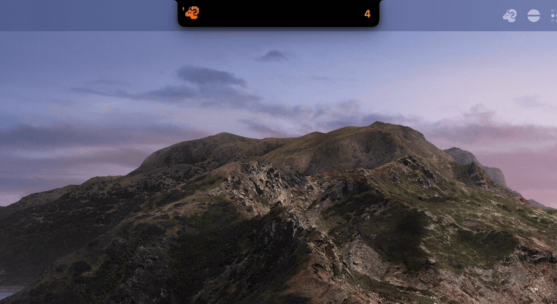
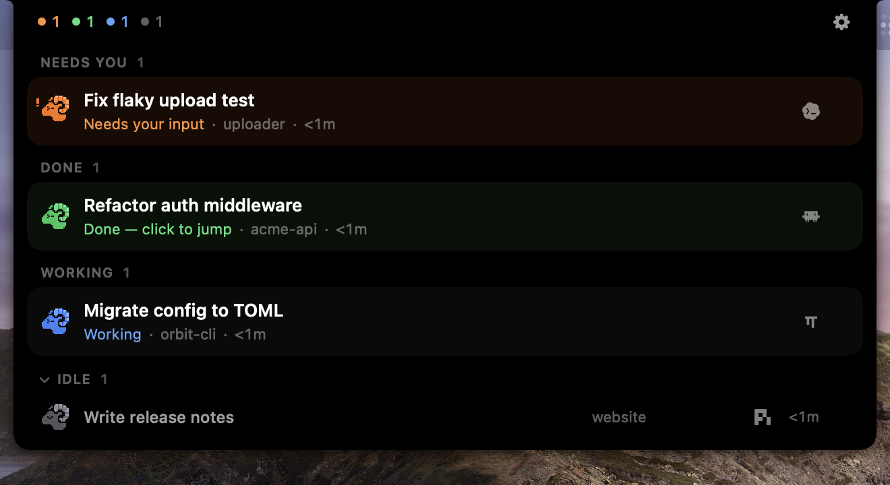

<p align="center">
  
</p>

<h1 align="center">Herdr Perch</h1>

<p align="center">
  Your <a href="https://github.com/herdrdev/herdr">Herdr</a> agents, perched in the MacBook notch.
</p>

<p align="center">
  <a href="https://github.com/Hariketsu/herdr-perch/actions/workflows/ci.yml"></a>
  <a href="https://github.com/Hariketsu/herdr-perch/releases/latest"></a>
  <a href="https://github.com/Hariketsu/herdr-perch/releases"></a>
  <br>
  
  
  <a href="https://github.com/herdrdev/herdr"></a>
  <a href="LICENSE"></a>
</p>

<p align="center">
  
</p>

## What it does

- **Every agent at a glance.** A pixel ram in the notch takes the colour of your most urgent agent; hover to see them all, grouped into *Needs you*, *Done*, *Working* and a folded *Idle*.
- **Speaks up when it matters.** When an agent asks for approval or input, the notch opens on its own (you can turn this off). When one finishes, the notch briefly shows `✓ title`.
- **One click back.** Click a row to focus that agent's pane in Herdr and bring your terminal to the front.
- **Zero setup.** Perch finds every local Herdr session by itself and follows them as they start, stop and reconnect.
- **Stays out of the way.** No Dock icon, no extra processes; it idles at well under 1% CPU.

<p align="center">
  
</p>

<!-- TODO: screenshots — collapsed styles (Clean / Dots / Counts), settings -->

## Requirements

- macOS 14 Sonoma or later on Apple silicon. Built for MacBooks with a notch; on other displays Perch draws a notch-shaped panel at the top of the screen.
- [Herdr](https://github.com/herdrdev/herdr) 0.9.5 or later, running locally.

## Install

Download `Herdr-Perch-<version>.dmg` from the [latest release](https://github.com/Hariketsu/herdr-perch/releases/latest), open it and drag **Herdr Perch** into **Applications**.

The app is not notarized yet, so macOS blocks it the first time you open it. To allow it, open **System Settings → Privacy & Security**, scroll down and click **Open Anyway** next to the message about Herdr Perch. You only need to do this once.

## How it works

Perch is a read-only companion. It connects directly to each Herdr server's Unix socket, subscribes to agent status events, and shows exactly what `herdr agent list` reports — it never guesses a state Herdr did not report. It does not install hooks into your agents, change Herdr's configuration, or start any processes. The only thing it ever asks Herdr to do is focus a pane, and only when you click a row.

Agent titles from tools such as oh-my-pi carry prompt characters and Nerd Font icons (`π > 󰈙 …`); Perch strips them for display. You can turn this off in Settings.

Clicking a row brings your terminal forward if it is Ghostty, Terminal, iTerm2, kitty, WezTerm, Alacritty or Warp.

## Settings

Open Settings from the gear in the expanded notch, or from the ram in the menu bar.

| Setting | Options |
|---|---|
| Notch style | Clean (count) · Dots (one per agent) · Counts (per state) |
| Rows | Grouped · Detailed · Compact |
| Expand when an agent is blocked | On · Off |
| Display | Built-in Notch Display · Main Display |
| Clean agent titles | On · Off |
| Follow system "Reduce motion" | Off · On |
| Launch at login | Off · On |

## Build from source

Requires Xcode 16 or later (Swift 6).

```sh
git clone https://github.com/Hariketsu/herdr-perch.git
cd herdr-perch
scripts/bundle.sh          # builds dist/Herdr Perch.app
open "dist/Herdr Perch.app"
scripts/make-dmg.sh        # optional: dist/Herdr-Perch-<version>.dmg
```

Tests:

```sh
swift test                                                   # unit tests
uv run --project Tests/E2E pytest Tests/E2E -p no:cacheprovider   # end-to-end, against a throwaway Herdr session
```

`perchctl dump | watch` prints the state Perch derives from Herdr, which is handy for debugging. Design notes (in Chinese) live in [`docs/spec`](docs/spec).

## Acknowledgments

- [NotchAgent](https://github.com/ykushch/notchagent) by Yuri Kushch — parts of the Herdr client and terminal activation are derived from it (Apache-2.0, see [NOTICE](NOTICE)).
- [Vibe Island](https://vibeisland.app) — the reference for the notch's look and motion.
- [Lobe Icons](https://github.com/lobehub/lobe-icons) and [oh-my-pi](https://github.com/can1357/oh-my-pi) — the agent marks (MIT).
- [Herdr](https://github.com/herdrdev/herdr), for an API that makes companions like this possible.

## License

[GPL-3.0](LICENSE). Herdr Perch is an independent project and is not affiliated with or endorsed by Herdr. Agent marks are trademarks of their respective owners and are used only to identify agents.
