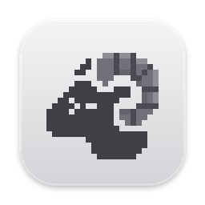
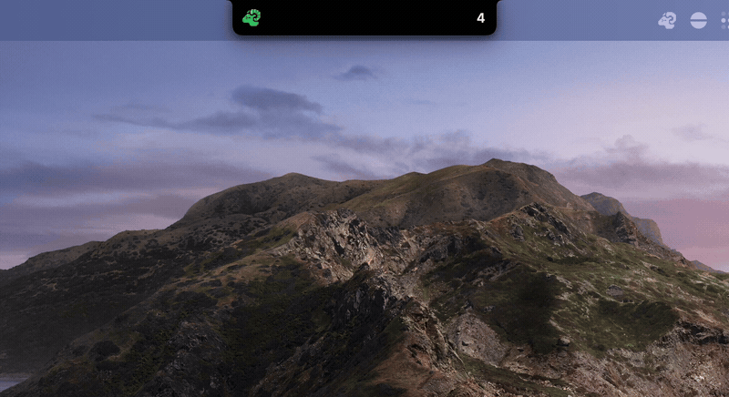
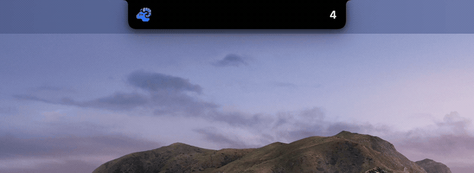

<p align="center">
  
</p>

<h1 align="center">Herdr Perch</h1>

<p align="center">
  让你的 <a href="https://github.com/herdrdev/herdr">Herdr</a> Agent 栖息在 MacBook 的刘海里。
</p>

<p align="center">
  <a href="README.md">English</a> · 简体中文
</p>

<p align="center">
  <a href="https://github.com/Hariketsu/herdr-perch/actions/workflows/ci.yml"></a>
  <a href="https://github.com/Hariketsu/herdr-perch/releases/latest"></a>
  <a href="https://github.com/Hariketsu/herdr-perch/releases"></a>
  <br>
  
  
  <a href="https://github.com/herdrdev/herdr"></a>
  <a href="LICENSE"></a>
</p>

<p align="center">
  
</p>

## 功能

- **所有 Agent 一目了然。** 刘海里的像素公羊显示最紧急的那个 Agent 的状态色；悬停即可看到全部 Agent，按 *Needs you*（需要你处理）、*Done*（已完成）、*Working*（工作中）分组，*Idle*（空闲）默认折叠。
- **该提醒时才提醒。** Agent 请求审批或等待输入、完成任务，或者 Herdr 连接中断时，刘海只弹出相关的那张卡片（Peek）；悬停可以看到全部。完成时的 Peek 可以在设置里关闭。
- **一键回到现场。** 点击任意一行，就会在 Herdr 里聚焦那个 Agent 的 pane，并把终端切到前台。
- **无需配置。** Perch 会自动发现本机所有 Herdr Session，并跟随它们启动、停止和重连。
- **安静不打扰。** 没有 Dock 图标，不启动额外进程；空闲时 CPU 占用远低于 1%。

<p align="center">
  
</p>

## 系统要求

- macOS 14 Sonoma 或更高版本，Apple 芯片。为带刘海的 MacBook 设计；在其他显示器上，Perch 会在屏幕顶部画一个刘海形状的面板。
- [Herdr](https://github.com/herdrdev/herdr) 0.9.5 或更高版本，在本机运行。

## 安装

从 [最新版本](https://github.com/Hariketsu/herdr-perch/releases/latest) 下载 `Herdr-Perch-<版本>.dmg`，打开后把 **Herdr Perch** 拖进 **应用程序**。

App 目前还没有经过 Apple 公证，第一次打开时 macOS 会拦截。放行方法：打开 **系统设置 → 隐私与安全性**，向下滚动，在关于 Herdr Perch 的提示旁点击 **仍要打开**。只需要操作一次。

## 工作原理

Perch 是一个只读的伴侣应用。它直接连接每个 Herdr 服务器的 Unix socket，订阅 Agent 状态事件，显示的内容与 `herdr agent list` 报告的完全一致，从不猜测 Herdr 没有报告的状态。它不会往你的 Agent 里注入 hooks，不修改 Herdr 的配置，也不启动任何进程。它唯一会请求 Herdr 做的事，是在你点击某一行时聚焦对应的 pane。

oh-my-pi 等工具生成的 Agent 标题会带有提示符和 Nerd Font 图标（`π > 󰈙 …`），Perch 显示时会去掉它们。这个行为可以在设置里关闭。

点击某一行时，如果你的终端是 Ghostty、Terminal、iTerm2、kitty、WezTerm、Alacritty 或 Warp，Perch 会把它切到前台。

## 设置

在展开的刘海里点齿轮，或者点菜单栏里的公羊，都可以打开设置。

| 设置项 | 选项 |
|---|---|
| 收起样式（Notch style） | Clean（数量）· Dots（每个 Agent 一个点）· Counts（按状态计数） |
| 完成时弹出 Peek（Peek when an agent finishes） | 开 · 关 |
| 显示器（Display） | 内建刘海屏 · 主显示器 |
| 清理 Agent 标题（Clean agent titles） | 开 · 关 |
| 系统要求时减少动态效果（Reduce motion when the system asks to） | 关 · 开 |
| 登录时启动（Launch at login） | 关 · 开 |

## 从源码构建

需要 Xcode 16 或更高版本（Swift 6）。

```sh
git clone https://github.com/Hariketsu/herdr-perch.git
cd herdr-perch
scripts/bundle.sh          # 构建 dist/Herdr Perch.app
open "dist/Herdr Perch.app"
scripts/make-dmg.sh        # 可选：生成 dist/Herdr-Perch-<版本>.dmg
```

测试：

```sh
swift test                                                   # 单元测试
uv run --project Tests/E2E pytest Tests/E2E -p no:cacheprovider   # 端到端测试，使用一次性的 Herdr Session
```

`perchctl dump | watch` 会打印 Perch 从 Herdr 推导出的状态，调试时很有用。设计文档在 [`docs/spec`](docs/spec)。

## 致谢

- [Herdr](https://github.com/herdrdev/herdr)：它的 API 让这类伴侣应用成为可能。
- [Vibe Island](https://vibeisland.app) 与 [open-vibe-island](https://github.com/Octane0411/open-vibe-island)：刘海外观与动效的参照；浮层窗口和指针处理源自 open-vibe-island（GPL-3.0）。
- [NotchAgent](https://github.com/ykushch/notchagent)：Herdr 客户端和终端激活的部分代码源自这里。
- [Lobe Icons](https://github.com/lobehub/lobe-icons) 与 [oh-my-pi](https://github.com/can1357/oh-my-pi)：Agent 图标（MIT）。

## 许可证

[GPL-3.0](LICENSE)。Herdr Perch 是独立项目，与 Herdr 没有隶属或背书关系。Agent 图标是其各自所有者的商标，仅用于标识 Agent。
